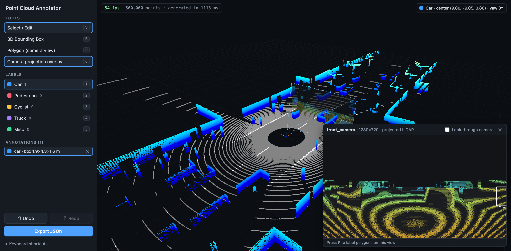

# 3D Point Cloud Annotator

A web-based tool for labeling objects in 3D point clouds, built for ML teams who need training labels on LiDAR or depth-sensor data. It renders a 500K-point scene with THREE.js/WebGL. You draw and edit **3D bounding boxes** in the cloud and **2D segmentation polygons** on a projected camera view, then export everything as JSON.



## Features

| | |
|---|---|
| **WebGL point cloud renderer** | THREE.js `Points` on a single `BufferGeometry` (positions and colors as GPU buffers). It ships with a synthetic 500,000-point, 64-beam LiDAR scan of a city street, which is generated in a Web Worker. |
| **3D navigation** | `OrbitControls`: left-drag orbits, right-drag pans, the wheel zooms. Uses LiDAR Z-up convention with damping. |
| **3D bounding boxes** | Drag on the ground to draw a box (its height comes from the label class). The face under the cursor highlights. Selected boxes get 6 drag handles that resize one face while the opposite face stays fixed. Drag a box body to move it, and use `[` / `]` to rotate yaw. |
| **Polygon labeling** | Click vertices on the projected camera view. Close the polygon by clicking the first vertex, double-clicking or pressing Enter. Polygons are stored in image pixel coordinates. |
| **Label palette** | Sidebar of color-coded classes (car, pedestrian, cyclist, truck, misc) with per-class counts. Picking a class while something is selected relabels it. |
| **Undo / redo** | Snapshot history (200 steps) covering create, move, resize, rotate, relabel and delete. |
| **Keyboard shortcuts** | See the table below. |
| **Camera projection overlay** | A virtual front camera with intrinsics and extrinsics. The LiDAR is projected into its 1280×720 image plane (depth-colored, z-buffered), with 3D boxes drawn as projected wireframes. The same image is texture-mapped onto a plane inside that camera's frustum in 3D. "Look through camera" moves the 3D view onto the sensor pose so the plane lines up with the points behind it. |
| **JSON export** | Boxes (label, center position, dimensions, yaw), polygons (label, view, vertices), label set and camera calibration. |

### Keyboard shortcuts

| Key | Action |
|---|---|
| `V` / `B` / `P` | Select tool / box tool / polygon tool |
| `C` | Toggle camera projection overlay |
| `1`–`5` | Choose label class (relabels the selection) |
| `L` | Cycle to the next label |
| `Delete` / `Backspace` | Delete the selected annotation (removes the last vertex while drawing a polygon) |
| `⌘Z` / `Ctrl+Z` | Undo |
| `⌘⇧Z` / `Ctrl+Shift+Z` / `Ctrl+Y` | Redo |
| `[` / `]` | Rotate the selected box ±5° |
| `Enter` / `Esc` | Close / cancel the polygon being drawn. `Esc` also deselects. |
| `Alt`+drag | Orbit while the box tool is active |

## Running

```bash
npm install
npm run dev          # http://localhost:5173
npm run build        # type-check + production build into dist/
```

Requires Node 18+ and a WebGL2-capable browser.

## Architecture

```
┌──────────────────────────── React (UI state) ────────────────────────────┐
│ App.tsx                                                                  │
│  ├─ useAnnotationStore()  ── undo/redo history of Annotation[]          │
│  ├─ useKeyboardShortcuts()                                               │
│  ├─ Sidebar           tools · label palette · annotation list · export  │
│  ├─ Viewport  ──────────┐                                                │
│  └─ CameraOverlay  ─────┼─ 2D canvas: projected LiDAR + boxes + polygons │
└─────────────────────────┼────────────────────────────────────────────────┘
          syncBoxes()     │  callbacks: onCreateBox / onUpdateBox / onSelect
                          ▼
┌──────────────── Viewer.ts (imperative THREE.js) ────────────────┐
│ WebGLRenderer · PerspectiveCamera · OrbitControls               │
│ Points (500K, BufferGeometry)   Box meshes + edges + handles    │
│ Raycasting: hover faces, drag handles, draw on ground plane     │
│ Image plane + frustum (CanvasTexture from CameraOverlay)        │
└─────────────────────────────────────────────────────────────────┘
          ▲ transferable Float32Arrays
┌─────────┴──────────────┐      ┌──────────────────────────────┐
│ pointCloud.worker.ts   │      │ sensorCamera.ts              │
│ syntheticScene.ts      │      │ intrinsics, projectToImage() │
│ (64-beam LiDAR raycast)│      └──────────────────────────────┘
└────────────────────────┘
```

```
src/
  annotations/   types, label classes, undo/redo store, JSON export
  components/    Viewport, Sidebar, CameraOverlay (+ CSS modules)
  data/          synthetic LiDAR generator + Web Worker loader
  hooks/         keyboard shortcuts
  scene/         Viewer (THREE.js), virtual sensor camera
bench/           fps benchmark (puppeteer)
```

**Key decision: React owns the data, THREE.js owns the frame.** Annotation state lives in a React reducer, which keeps undo/redo simple and serializable. The `Viewer` class is imperative and reconciles boxes from that state with `syncBoxes()`. During a drag the viewer mutates meshes directly and dispatches **one** update on pointer-up. That keeps React re-renders out of the 60 fps loop and gives exactly one undo step per gesture.

## UX design notes

- **One gesture, one undo step.** Moving, resizing and drawing preview live in 3D but commit only on release.
- **Navigation never needs a mode switch.** In select mode, dragging empty space orbits and dragging a box edits it. In box mode, `Alt`+drag orbits. Right-drag pans and the wheel zooms in every mode.
- **Visible affordances.** The face under the cursor brightens. Handles appear only on the selected box and grow and turn yellow on hover. The cursor changes to `move` or `grab` accordingly. A heading line marks each box's +x (forward) face.
- **Sensible defaults.** A new box takes its class's typical height (a car is 1.6 m, a pedestrian 1.8 m), so a single footprint drag usually gives a usable box. Rotation snaps in 5° steps.
- **Labels are fast to change.** Number keys pick a class. With a selection, the same key relabels it, and `L` cycles through classes.
- **2D and 3D stay consistent.** 3D boxes are drawn as projected wireframes in the camera view, and the camera image appears in the 3D scene, so annotators can check labels across views.
- **Polygon drafting is forgiving.** Backspace or `⌘Z` removes the last vertex, `Esc` cancels, and a ring marks the first vertex as the snap-to-close target.

## Export format

```json
{
  "format": "pointcloud-annotator/v1",
  "scene": { "name": "synthetic-urban-lidar", "pointCount": 500000, "frame": "lidar", "units": "meters", "up": "z" },
  "labels": [{ "id": "car", "name": "Car", "color": "#3b9dff" }, "..."],
  "cameras": [{ "name": "front_camera", "intrinsics": { "fx": 869.1, "fy": 869.1, "cx": 640, "cy": 360, "width": 1280, "height": 720 }, "extrinsics": { "...": "..." } }],
  "boxes": [{ "id": "box_…", "label": "car", "position": { "x": 9.8, "y": -5.6, "z": 0.8 }, "dimensions": { "length": 4.5, "width": 1.9, "height": 1.6 }, "yaw": 0.087 }],
  "polygons": [{ "id": "poly_…", "label": "pedestrian", "view": "front_camera", "vertices": [[512.0, 360.5], [610.2, 355.0], [618.4, 470.1]] }]
}
```

## Performance

**Result: 60.0 fps average on the 500K-point scene during continuous orbit and pan, which is the display's 60 Hz vsync cap.**

| Run | Avg fps | p50 frame | p95 frame | p99 frame | Max frame | Frames > 20 ms |
|---|---|---|---|---|---|---|
| 1 | 60.0 | 16.7 ms | 17.5 ms | 17.7 ms | 17.7 ms | 0 |
| 2 | 60.0 | 16.7 ms | 17.4 ms | 17.6 ms | 17.7 ms | 0 |
| 3 | 60.0 | 16.7 ms | 17.4 ms | 17.6 ms | 17.7 ms | 0 |

Setup: production build (`vite build && vite preview`), Chrome on macOS with an Apple M5 GPU (ANGLE/Metal). The canvas was 2380×1450 physical pixels (DPR 2). Each run lasted 10 s and alternated 1 s of orbit (left-drag) with 1 s of pan (right-drag).

**Method.** `bench/fps-benchmark.mjs` launches headed Chrome with the real GPU and waits for the cloud to load. It then drives real mouse drags over the canvas with puppeteer while recording every `requestAnimationFrame` timestamp in the page. The viewer renders once per rAF, so this is the render rate. A live fps meter also sits in the viewer's top-left corner for manual checks in DevTools.

```bash
npm run build && npx vite preview --port 5180 &
npm run bench -- --url http://localhost:5180 --seconds 10
```

Why it holds 60 fps: all 500K points are a single draw call from static GPU buffers. Points use a fixed 2 px size without attenuation, so close-ups don't create overdraw spikes. Raycasting only tests the handful of box meshes and an analytic ground plane, never the cloud. The fps meter writes straight to the DOM instead of re-rendering React. The scene itself (about 1.1 s of ray casting) is generated in a Web Worker, so the UI never blocks.

Caveat: rAF is capped at the display refresh rate, so 60 fps here means the frame budget was never missed, not that the renderer tops out at 60. Opening the camera overlay costs one dip of a few frames while the 500K points are projected on the CPU into the 2D image.

## Scope notes

- The demo data is synthetic. Ray-cast LiDAR gives realistic ring patterns, occlusion shadows and lane markings. There is no file loader (for example PCD or LAS) yet.
- The "camera image" is the LiDAR projected into a virtual camera's image plane. No real RGB frame is bundled.
- Boxes rotate around yaw only, which is the usual convention for driving datasets.
